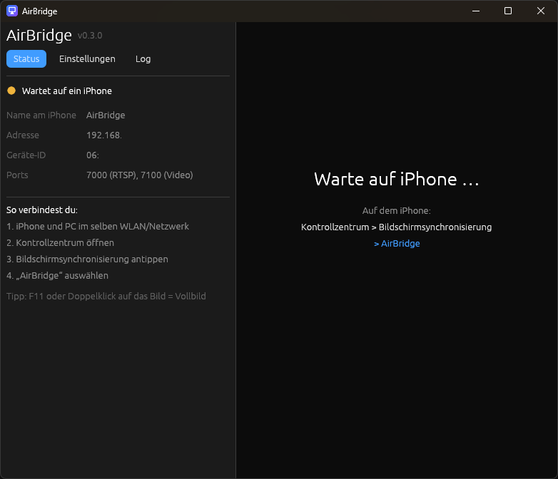
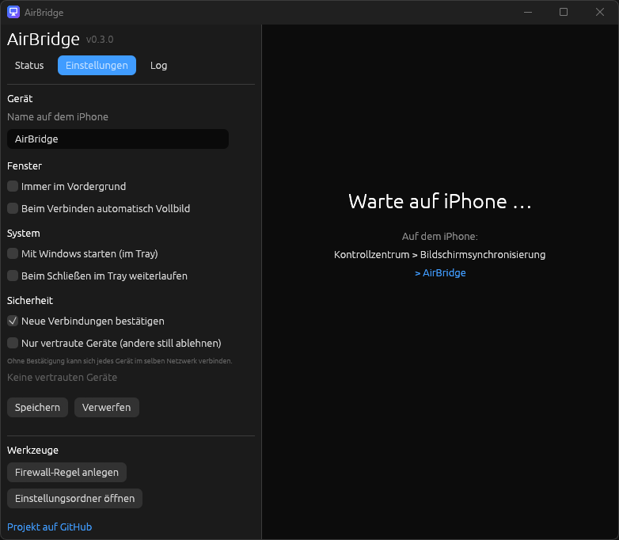

# AirBridge

[](https://github.com/30jannik06/AirBridge/actions/workflows/ci.yml)
[](LICENSE)

**A lean, native AirPlay screen-mirroring receiver for Windows, written in Rust.**
Mirror your iPhone from Control Center → Screen Mirroring to a Windows PC. No app on the iPhone, no Apple software on the PC.

🇩🇪 [Deutsche Version](README.de.md)

- **One small executable** (about 7 MB), no runtime dependencies.
- **Friendly interface:** status, settings, live log, tray icon, optional "allow this device?" prompt.
- **Low latency video:** H.264 decoded by the decoder built into Windows (Media Foundation), plus a window with fullscreen.
- **Music:** AirPlay audio (ALAC) with a "now playing" view: cover, title, progress, spectrum and play/pause/next buttons.
- **Sound while mirroring** (optional, build-time feature): AAC-ELD via FDK-AAC, see the note below.
- **Installer or portable:** both are provided on the releases page.

## Screenshots

| Waiting | Settings |
|---|---|
|  |  |

## Status

Tested with an iPhone on Windows 11. Working: discovery, pairing, video, music, rotation, fullscreen, settings, tray. Sound while mirroring works in self-built versions.

Known limitations:

- Windows only, one iPhone at a time.
- No DRM content (Netflix, Disney+, …): iOS itself blocks that while mirroring.
- Audio and video are not precisely synchronised.
- Sound while screen mirroring is only in self-built versions (see the note below). Music works in the downloads.
- Not tested: iPad, Mac, several simultaneous connections, very old iOS versions.

## Install

Download from the [Releases](https://github.com/30jannik06/AirBridge/releases) page:

| Variant | For whom | How |
|---|---|---|
| **Setup** (`AirBridge-Setup-x.y.z.exe`) | Normal use | Run it: installs to Program Files, adds a Start menu entry and the firewall rule. |
| **Portable** (`AirBridge-x.y.z-portable.zip`) | USB stick, no admin rights | Unzip anywhere, run `airbridge.exe`. Settings stay next to the exe (marked by `portable.txt`). |

> **About sound in the downloads.** Music from the iPhone (AirPlay audio) works out of the box. The sound that goes with
> **screen mirroring** uses the AAC-ELD codec (FDK-AAC), whose licence is not compatible with the GPL, so the prebuilt
> binaries leave it out. To get that sound too, build it yourself with `--features nonfree-audio`, see
> [docs/BUILDING.md](docs/BUILDING.md). Details: [THIRD_PARTY_NOTICES.md](THIRD_PARTY_NOTICES.md).

## Usage

1. PC and iPhone must be on the **same network** (no guest Wi-Fi with client isolation, no VPN in between).
2. Start AirBridge. A window "AirBridge – waiting for iPhone …" opens.
3. On the iPhone: **Control Center → Screen Mirroring → AirBridge**.

| Input | Effect |
|---|---|
| `F11` or double click | Toggle fullscreen |
| `Esc` | Leave fullscreen |
| Close window | Quit |

The window follows the picture size (e.g. when you rotate the phone).

### Updates

AirBridge can tell you when a new version is out (off by default, see *Security and privacy*). It only points you to the
release page, nothing is installed automatically. **Installed:** run the new Setup, it closes AirBridge if needed and
replaces the old version; your settings stay. **Portable:** unzip the new ZIP over the old folder; key and settings stay.

### Music

Play music (or a video) on the iPhone and pick **AirBridge** with the AirPlay button. The window shows cover, title, artist,
a progress bar and a live spectrum. The iPhone volume buttons control AirBridge's volume. If the iPhone allows remote
control, the play/pause/previous/next buttons work too; otherwise control the music on the phone.

### Settings

The left panel has three tabs: **Status** (connection, address, resolution, latency), **Settings** and **Log**.
In *Settings* you can change the device name shown on the iPhone, keep the window on top, go fullscreen automatically,
start with Windows (in the tray), keep running in the tray when the window is closed, check for updates, and require a confirmation before
a new device may connect ("Allow once / Always / Deny"). Settings are stored in `settings.json` next to the key file.
Start with `--minimized` to begin in the tray.

### Firewall rule

The installer creates it for you. For the portable version (or after moving the exe):

```powershell
.\airbridge.exe --install-firewall   # asks for administrator rights (UAC)
.\airbridge.exe --remove-firewall
```

The rule allows **inbound** connections for AirBridge on private and domain networks only.

### Ports

| Port | Protocol | Purpose |
|---|---|---|
| 5353 | UDP | mDNS / Bonjour: makes AirBridge visible |
| 7000 | TCP | RTSP/HTTP: pairing, FairPlay, session setup |
| 7100 | TCP | Video stream |
| dynamic | UDP | Time sync (NTP) and audio |

## Build from source

```powershell
cargo build --release                           # what the releases use (music, no mirroring sound)
cargo build --release --features nonfree-audio  # plus sound while mirroring, for your own use only (do not redistribute)
```

Prerequisites and EDR/antivirus hints: [docs/BUILDING.md](docs/BUILDING.md).

## Documentation

- [Architecture](docs/ARCHITECTURE.md): modules and data flow
- [Protocol notes](docs/PROTOCOL.md): how the AirPlay mirroring handshake works (the hard-won knowledge)
- [Building](docs/BUILDING.md)
- [Troubleshooting](docs/TROUBLESHOOTING.md)
- [Roadmap](docs/ROADMAP.md) (including Linux)
- [Contributing](CONTRIBUTING.md), [Security policy](SECURITY.md), [Changelog](CHANGELOG.md)

## Security and privacy

- AirBridge listens on the local network and has **no PIN or password**: any device on the same network can connect. Use it on networks you trust.
- By default it never contacts the internet. The only exception is the optional update check (Settings → "Check for updates at startup" is off by default, or the button "Jetzt nach Updates suchen"): it sends one normal HTTPS request to the GitHub API and sends no data about you.
- The receiver's private key (`airbridge_key.bin`) lives in `%APPDATA%\AirBridge` (installed) or next to the exe (portable). Do not share it.

## Licence

GPL-3.0-only, see [LICENSE](LICENSE). It includes the GPL-licensed `playfair` code from UxPlay, so the whole program is GPL.
Third-party components: [THIRD_PARTY_NOTICES.md](THIRD_PARTY_NOTICES.md).

AirPlay, FairPlay and iPhone are trademarks of Apple Inc. AirBridge is an independent project and not affiliated with Apple.

## Acknowledgements

Thanks to the open-source AirPlay community: **UxPlay**, **shairplay** and everyone who documented the protocol.
